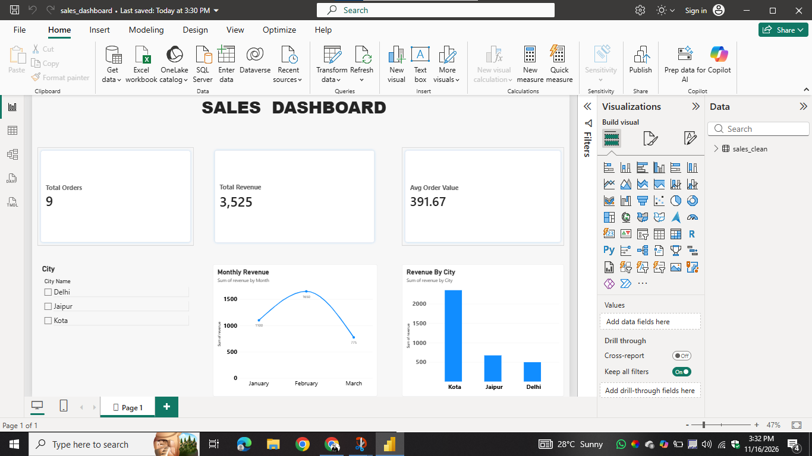

# Power BI Sales Dashboard

## Objective
Build an interactive dashboard to track revenue, orders and average order value, and to compare performance by city and month.

## Tools
Power BI Desktop (DAX measures, slicers, charts)

## Dataset
9 cleaned sales orders (Jan-Mar 2026) with city, product, quantity and price. Revenue = qty x price. The same dataset is used in my SQL, Pandas and Excel projects.

## What I Did
- Loaded the cleaned CSV into Power BI and built a column chart (revenue by city) and a line chart (monthly revenue)
- Created DAX measures: Total Revenue, Total Orders and Avg Order Value
- Added KPI cards and a city slicer so the whole dashboard filters on one click

## Dashboard

## Key Insights
- Total revenue: 3,525 across 9 orders (average order value about 391.67)
- February was the best month (1,650), March the lowest (775)
- Kota contributed the most revenue (2,350), Delhi the least (500)

## Files
- sales_dashboard.pbix: Power BI report file
- powerbi_dashboard.png: dashboard screenshot
